# Практична робота №11: автоматизоване тестування та документування API

## Варіант 4: Ресторан та доставка їжі

| Розділ Swagger (`@ApiTags`) | Сутності для тестів | Граничний випадок валідації |
|---|---|---|
| `Меню та доставка страв` | `DishesService`, `DishesController` | некоректна калорійність або від'ємна вага страви |

Проєкт продовжує ПР10. Додано модульні тести сервісу й контролера страв з мокуванням залежностей, звіт покриття коду та інтерактивну документацію OpenAPI 3.0 (Swagger UI) з Bearer JWT-авторизацією.

**Виконано:** рівень 1 і рівень 2. Рівень 3 (нові E2E-тести валідації та 401) і бонусне завдання (Dockerfile, деплой) не виконувалися. E2E-тести з попередніх робіт збережено, вони проходять.

---

## 1. Стек

| Компонент | Версія |
|---|---|
| NestJS | 12 |
| @nestjs/swagger / swagger-ui-express | 12.1 / 5.0 |
| Тести | Vitest 4 + @nestjs/testing |
| Покриття | @vitest/coverage-v8 |

> Від ПР5 проєкт використовує **Vitest** замість Jest: він швидше працює з ES-модулями (`"type": "module"`), а API майже ідентичний. Відповідності: `jest.fn()` → `vi.fn()`, `jest --coverage` → `vitest run --coverage`. `Test.createTestingModule()` і `getRepositoryToken()` з `@nestjs/testing` / `@nestjs/typeorm` використовуються так само, як у методичці.

```bash
npm i @nestjs/swagger swagger-ui-express
```

---

## 2. Рівень 1

### 2.1. Модульні тести `DishesService` (`src/dishes/dishes.service.spec.ts`)

Замість справжніх репозиторіїв TypeORM підставлено mock-об'єкти з `vi.fn()`:

```ts
const dishRepo = {
  create: vi.fn((dto) => Object.assign(new DishEntity(), dto)),
  save: vi.fn(async (e) => ({ ...makeDish(), ...e })),
  merge: vi.fn((target, src) => Object.assign(target, src)),
  findOne: vi.fn(),
  find: vi.fn(),
  count: vi.fn(),
  exists: vi.fn(async () => false),
  softDelete: vi.fn(),
  restore: vi.fn(),
  createQueryBuilder: vi.fn(),
};

const module = await Test.createTestingModule({
  providers: [
    DishesService,
    SlugService,
    { provide: getRepositoryToken(DishEntity), useValue: dishRepo },
    { provide: getRepositoryToken(MenuCategoryEntity), useValue: categoryRepo },
    { provide: getRepositoryToken(AllergenEntity), useValue: allergenRepo },
  ],
}).compile();
```

Ключові тести за шаблоном Arrange → Act → Assert:

```ts
it('create: успішно створює страву та викликає repo.save', async () => {
  const dto = { title: 'Вареники з вишнею', price: 175, weightGrams: 300, calories: 520, isSpicy: false };
  dishRepo.findOne.mockImplementation(async () => makeDish({ ...dto, slug: 'varenyky-z-vyshneyu' }));

  const result = await service.create(dto);

  expect(dishRepo.create).toHaveBeenCalledWith(expect.objectContaining({ ...dto, slug: 'varenyky-z-vyshneyu' }));
  expect(dishRepo.save).toHaveBeenCalledTimes(1);
  expect(result).toMatchObject({ id: DISH_ID, ...dto });
});

it('findOne: повертає страву за коректним ID', async () => {
  const dish = makeDish();
  dishRepo.findOne.mockResolvedValue(dish);
  await expect(service.findOne(DISH_ID)).resolves.toBe(dish);
});

it('findOne: кидає NotFoundException, якщо null', async () => {
  dishRepo.findOne.mockResolvedValue(null);
  await expect(service.findOne('x')).rejects.toThrow(NotFoundException);
});
```

Крім обов'язкових, покрито: створення з алергенами через cascade, неіснуючий розділ меню, побудову QueryBuilder для фільтрів (`innerJoinAndSelect`, параметризований `where`, `skip`/`take`), оновлення та перегенерацію slug, `softDelete`, `restore`, кошик і сидування. Для QueryBuilder написано фабрику `makeQueryBuilder()`, методи якої повертають `this`, тож ланцюжок викликів працює без БД.

Окремо `src/dishes/dto/create-dish.dto.spec.ts` перевіряє **граничні випадки варіанта** через `class-validator`:

| Вхід | Повідомлення |
|---|---|
| `weightGrams: -250` | `Вага страви не може бути меншою за 10 г` |
| `weightGrams: 250.5` | `Вага має бути цілим числом грамів` |
| `calories: -1` | `Калорійність не може бути від’ємною` |
| `calories: 99999` | `Калорійність не може перевищувати 5000 ккал` |
| `weightGrams: 10`, `calories: 0` / `5000` | допустимо |

Для цього в `CreateDishDto` / `UpdateDishDto` додано верхні межі (5000 г і 5000 ккал, константа `DISH_LIMITS`) і українські повідомлення.

### 2.2. Базова інтеграція Swagger

`src/swagger.ts`:

```ts
const config = new DocumentBuilder()
  .setTitle('Gourmet Express Delivery API')
  .setDescription('Технічна документація REST API сервісу доставки їжі (варіант 4): ...')
  .setVersion('1.0')
  .addBearerAuth({ type: 'http', scheme: 'bearer', bearerFormat: 'JWT', description: 'Access Token з POST /auth/login' })
  .build();

SwaggerModule.setup('api/docs', app, () => SwaggerModule.createDocument(app, config), {
  customSiteTitle: 'Gourmet Express Delivery API',
  swaggerOptions: { persistAuthorization: true, tagsSorter: 'alpha', operationsSorter: 'method' },
});
```

`main.ts` викликає `setupSwagger(app)`. Swagger UI доступний за адресою **http://localhost:4000/api/docs**, JSON-специфікація — **/api/docs-json**. Сторінку роздає Express напряму, тому глобальний `JwtAuthGuard` її не блокує.

Контролер страв позначено `@ApiTags('Меню та доставка страв')`, кожен метод — `@ApiOperation({ summary })`. Інші контролери теж мають свої теги: «Автентифікація», «Розділи меню», «Алергени», «Замовлення», «Користувачі (ADMIN)», «Сповіщення (SSE)», «Службові».

---

## 3. Рівень 2

### 3.1. Модульні тести `DishesController` (`src/dishes/dishes.controller.spec.ts`)

Сервіс замінено mock-об'єктом:

```ts
const service = { findAll: vi.fn(), findOne: vi.fn(), create: vi.fn(), update: vi.fn(), ... };

const module = await Test.createTestingModule({
  controllers: [DishesController],
  providers: [{ provide: DishesService, useValue: service }],
}).compile();
```

Тести перевіряють, що `create`, `findAll`, `findOne`, `update`, `remove`, `restore`, `findDeleted`, `findBySlug` і `replace` викликають відповідні методи сервісу з правильними аргументами та повертають їхній результат, а `NotFoundException` із сервісу передається далі.

### 3.2. Документування DTO

`@ApiProperty` / `@ApiPropertyOptional` з `description`, `example`, типом і обмеженнями (`minimum`, `maximum`, `maxLength`, `format`, `enum`) додано до всіх полів:

- `CreateDishDto`, `UpdateDishDto`, `QueryDishesDto` (страви);
- `RegisterDto`, `LoginDto`, `UpdateRoleDto`;
- `CreateMenuCategoryDto`, `UpdateMenuCategoryDto`, `CreateAllergenDto`, `CreateOrderDto`.

Схеми відповідей теж описані: `DishEntity`, `MenuCategoryEntity`, `AllergenEntity`, `PaginatedDishesDto` + `PaginationMetaDto`, `UserResponseDto` (без `passwordHash`), `AccessTokenDto`, `ErrorResponseDto`. Обмеження в Swagger збігаються з правилами `class-validator`, бо беруться з тих самих констант.

### 3.3. Коди відповідей

Кожен метод `DishesController` описує свої коди: `200`/`201`/`204` (успіх), `400` (валідація; на рівні класу), `404` (не знайдено), а захищені — ще `401` і `403`. Для кожної помилки в `ERROR_EXAMPLES` є реалістичний приклад: наприклад, для 403 — `Недостатньо прав для виконання операції`, для 400 — масив повідомлень про вагу та калорійність.

```ts
@Roles(Role.CHEF, Role.ADMIN)
@Post()
@HttpCode(HttpStatus.CREATED)
@ApiBearerAuth()
@ApiOperation({ summary: 'Створення страви (CHEF, ADMIN)', description: 'Нові алергени зі списку створюються автоматично (cascade).' })
@ApiCreatedResponse({ description: 'Страву успішно додано до меню', type: DishEntity })
@ApiUnauthorizedResponse({ description: 'Відсутній або недійсний токен', type: ErrorResponseDto, example: ERROR_EXAMPLES.unauthorized })
@ApiForbiddenResponse({ description: 'Недостатньо прав', type: ErrorResponseDto, example: ERROR_EXAMPLES.forbidden })
@ApiNotFoundResponse({ description: 'Розділ меню не знайдено', type: ErrorResponseDto, example: ERROR_EXAMPLES.notFound })
create(@Body() dto: CreateDishDto): Promise<DishEntity> { ... }
```

### 3.4. Bearer-авторизація в Swagger UI

- `DocumentBuilder.addBearerAuth()` додає схему `bearer (http, JWT)`;
- `@ApiBearerAuth()` стоїть на всіх маршрутах із `@Roles()` (зміни меню, кошик, алергени, розділи меню), на `/auth/me`, а також на класах `UsersController` і `OrdersController`. Тому біля них з'являється замок;
- публічні маршрути (`GET /dishes`, `GET /dishes/:id`, ...) замка не мають;
- `persistAuthorization: true` зберігає токен після перезавантаження сторінки.

Сценарій перевірки: `POST /auth/login` → «Try it out» → `Execute` → скопіювати `accessToken` → «Authorize» → вставити токен → `POST /dishes` повертає 201 замість 401.

### 3.5. Покриття коду

Налаштування у `vitest.config.ts`:

```ts
coverage: {
  provider: 'v8',
  include: ['src/**/*.ts'],
  exclude: ['src/**/*.spec.ts', 'src/main.ts', 'src/database/**', 'src/**/*.module.ts', 'src/**/*.interface.ts'],
  reporter: ['text', 'html', 'lcov'],
  reportsDirectory: './coverage',
},
```

```bash
npm run test:cov
```

| Область | Statements | Branches | Functions | Lines |
|---|---|---|---|---|
| **`src/dishes` (варіант)** | **98.13%** | 77.19% | **100%** | **98.05%** |
| `dishes.controller.ts` | 100% | 100% | 100% | 100% |
| `dishes.service.ts` | 97.89% | 77.19% | 100% | 97.8% |
| `src/dishes/dto` | 94.44% | 100% | 90% | 100% |
| Увесь проєкт | 63.98% | 59.04% | 61.58% | 63.4% |

HTML-звіт: `coverage/lcov-report/index.html` (reporter `lcov`) або `coverage/index.html` (reporter `html`).

Аналіз: модуль варіанта покритий майже повністю. Непокриті гілки в `dishes.service.ts` — це оператори `??` для значень за замовчуванням і рядок логера під час сидування. Загальний відсоток проєкту нижчий, бо модулі з попередніх робіт (розділи меню, алергени, користувачі, `TrimPipe`, `JwtStrategy`) перевіряються переважно e2e-тестами, а вони в unit-покриття не потрапляють.

---

## 4. Структура (нове та змінене)

```
PR11_WEB4/
├── vitest.config.ts                         # coverage: text + html + lcov
├── src/
│   ├── main.ts                              # setupSwagger(app)
│   ├── swagger.ts                           # DocumentBuilder, addBearerAuth, /api/docs
│   ├── common/dto/api-responses.dto.ts      # ErrorResponseDto, PaginationMetaDto, ERROR_EXAMPLES
│   ├── dishes/
│   │   ├── dishes.controller.ts             # @ApiTags, @ApiOperation, @ApiResponse, @ApiBearerAuth
│   │   ├── dishes.controller.spec.ts        # unit: mock сервісу
│   │   ├── dishes.service.spec.ts           # unit: mock репозиторіїв
│   │   ├── dto/create-dish.dto.ts           # @ApiProperty + межі ваги/калорійності
│   │   ├── dto/create-dish.dto.spec.ts      # граничні випадки варіанта
│   │   ├── dto/update-dish.dto.ts, query-dishes.dto.ts, paginated-dishes.dto.ts
│   │   └── entities/dish.entity.ts          # @ApiProperty для схеми відповіді
│   ├── auth/dto/*.ts                        # @ApiProperty, AccessTokenDto, UserResponseDto
│   └── .../*.controller.ts                  # @ApiTags / @ApiOperation / @ApiBearerAuth
└── coverage/                                # генерується (у .gitignore)
```

---

## 5. Інструкція із запуску

```bash
npm install
cp .env.example .env
docker compose up -d
npm run migration:run
npm run start:dev
```

- Swagger UI: http://localhost:4000/api/docs
- OpenAPI JSON: http://localhost:4000/api/docs-json
- Обліковий запис адміністратора: `admin@food.local` / `Admin12345`

Тести:

```bash
npm test             # усі unit-тести
npm run test:cov     # unit-тести + звіт покриття (coverage/)
npm run test:e2e     # e2e, потрібна запущена БД
```

---

## 6. Скриншоти

### 6.1. Запуск: адреса Swagger UI в логах
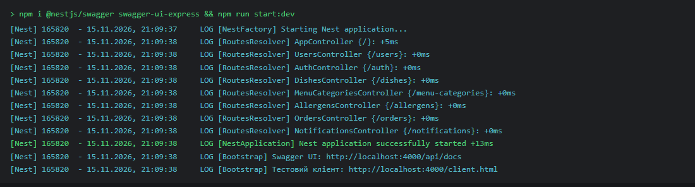

### 6.2. `curl -I /api/docs` (200, text/html) і специфікація `/api/docs-json`
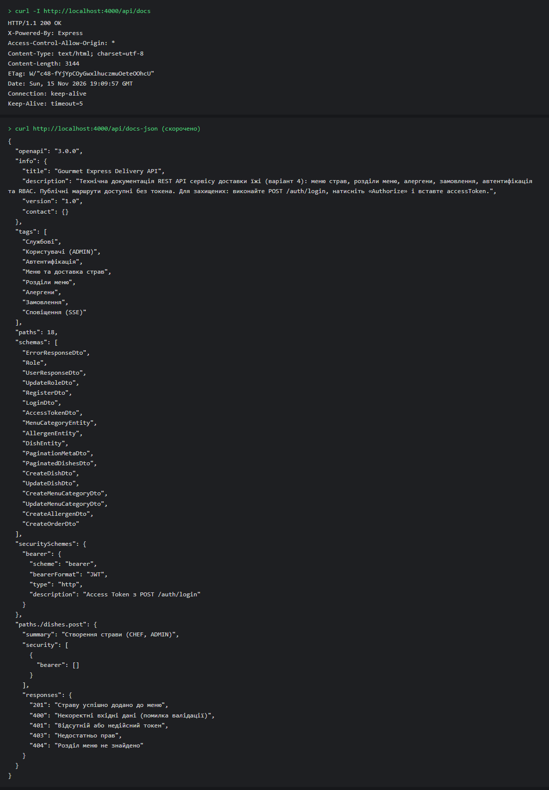

### 6.3. Swagger UI: теги, замки на захищених маршрутах, схеми
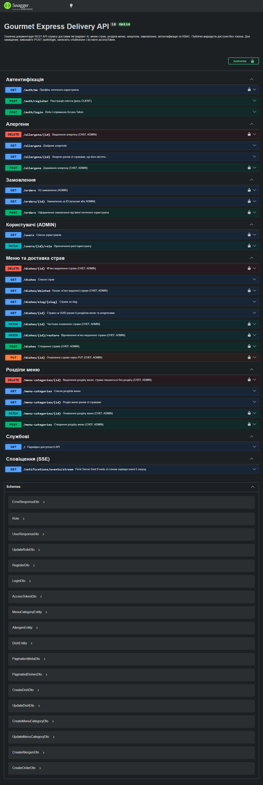

### 6.4. Документація `POST /dishes`: опис, приклади, коди 201/400/401/403/404
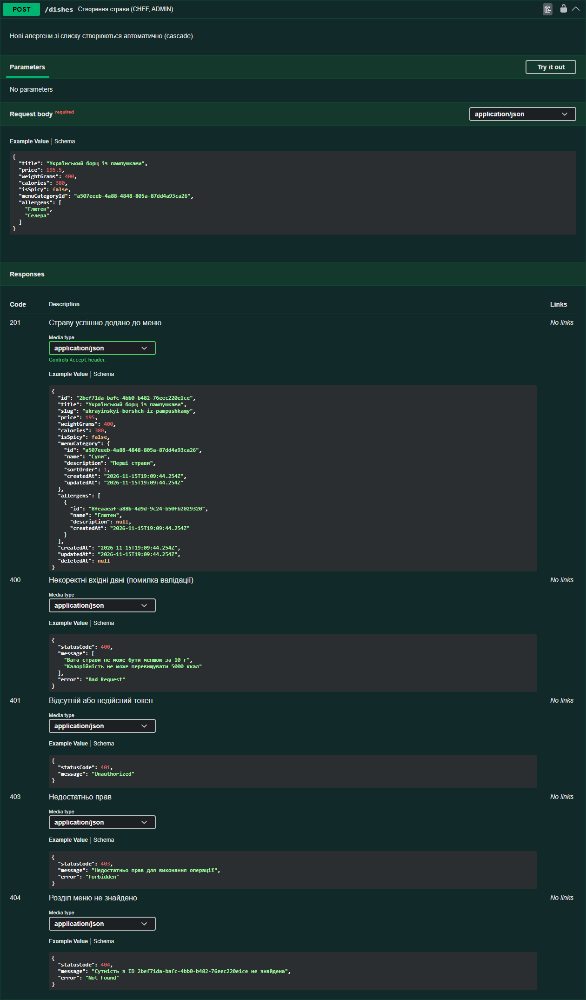

### 6.5. Схема `CreateDishDto` з описами, прикладами та межами
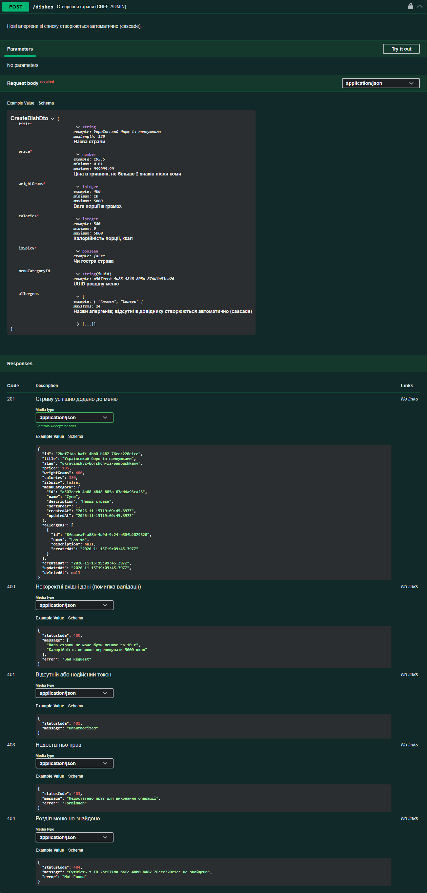

### 6.6. «Try it out» без токена: 401 Unauthorized
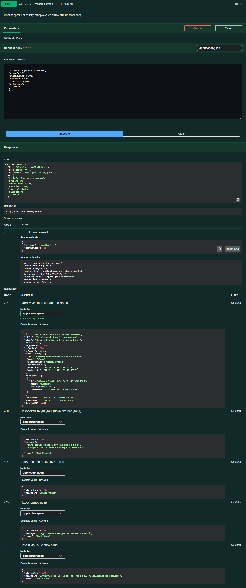

### 6.7. Логін у Swagger UI: отримання `accessToken`
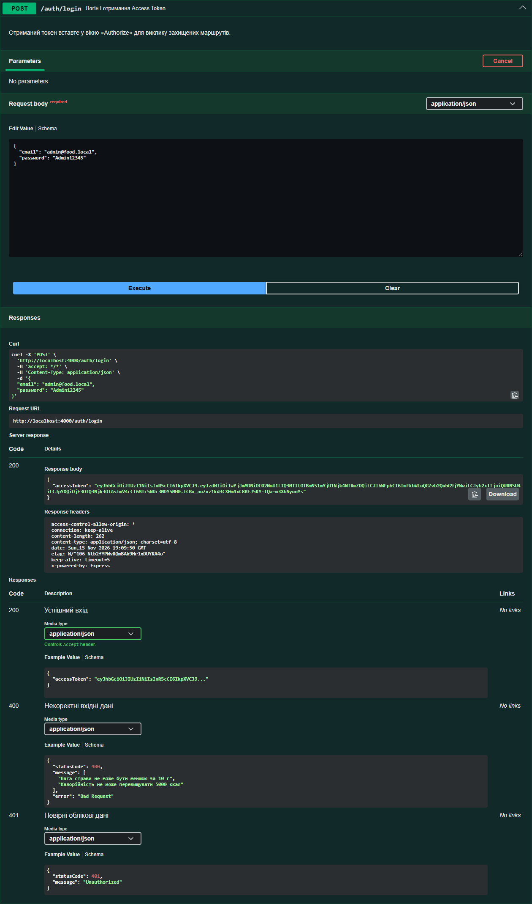

### 6.8. Вікно «Authorize»: токен застосовано
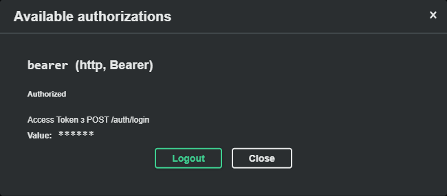

### 6.9. Той самий запит із токеном ADMIN: 201 Created (у curl видно заголовок `Authorization: Bearer`)
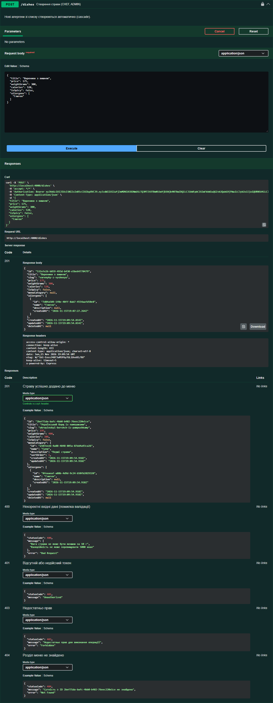

### 6.10. Граничний випадок варіанта: від'ємна вага та калорійність 99999 дають 400
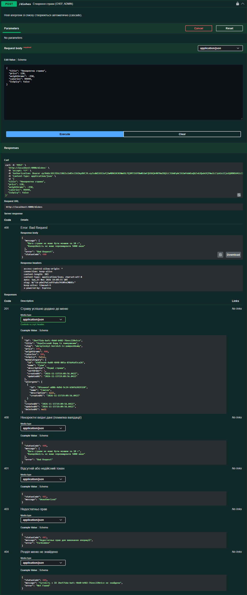

### 6.11. Unit-тести модуля страв (сервіс, контролер, DTO): 34/34
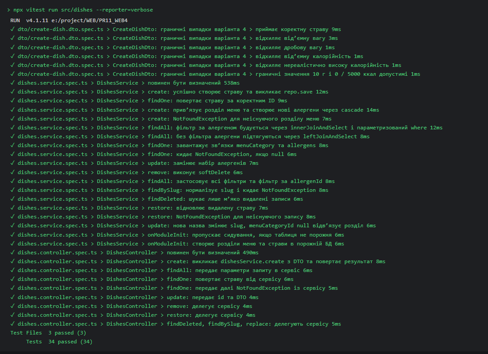

### 6.12. `npm run test:cov`: таблиця покриття в консолі
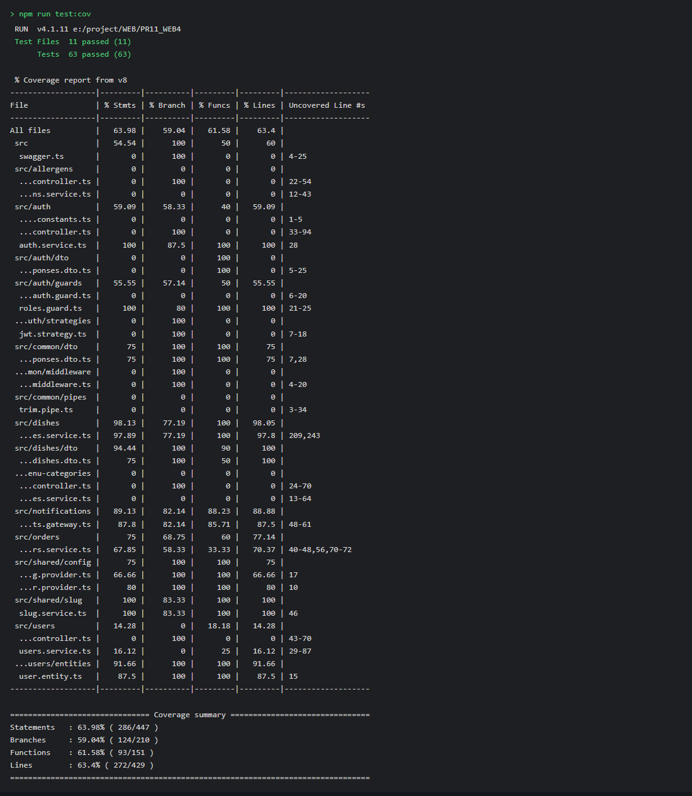

### 6.13. HTML-звіт покриття: усі файли
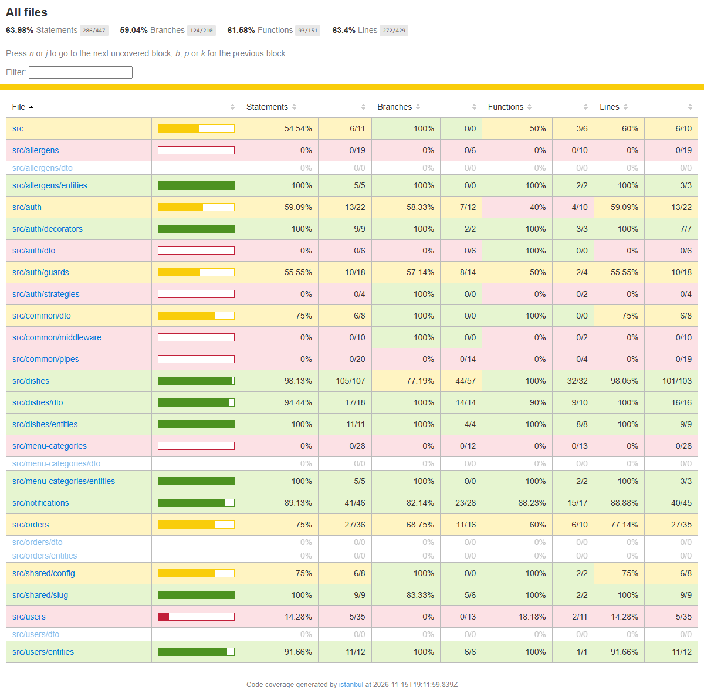

### 6.14. HTML-звіт покриття: `src/dishes`
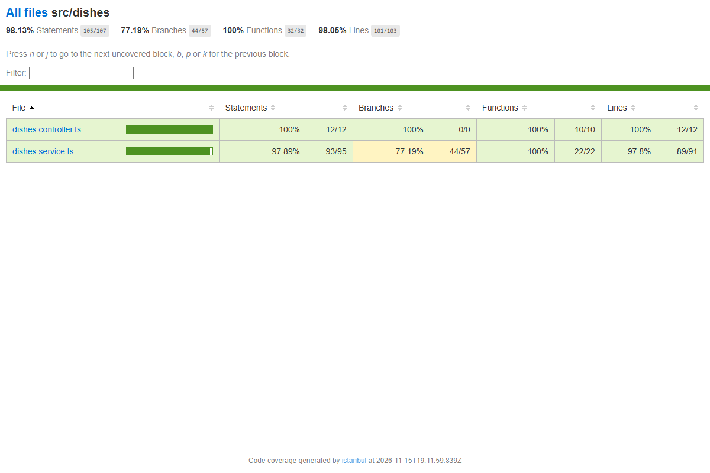

### 6.15. Усі тести без помилок: unit 63/63, e2e 3/3
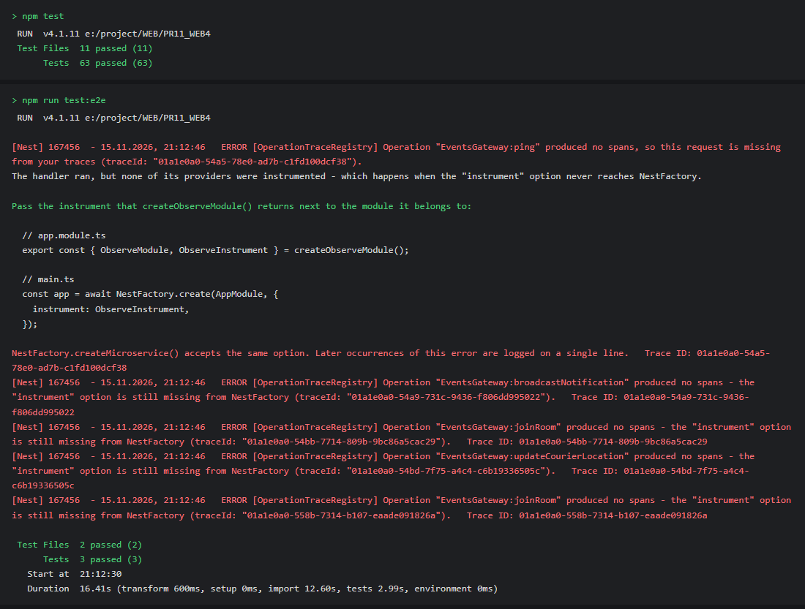

---

## 7. Висновки

Бізнес-логіку модуля страв покрито ізольованими модульними тестами: репозиторії TypeORM та сервіс замінено mock-об'єктами через `Test.createTestingModule()` і `getRepositoryToken()`, тож тести не потребують бази даних і виконуються за секунди. Граничні випадки варіанта (від'ємна вага, некоректна калорійність) перевіряються як на рівні DTO-валідації, так і вживу через Swagger. Модуль варіанта має 98% покриття рядків і 100% функцій. API задокументовано за специфікацією OpenAPI 3.0: кожен маршрут має опис, схему запиту та відповіді, коди помилок із прикладами. Захищені маршрути позначені `@ApiBearerAuth()`, і їх можна викликати прямо з Swagger UI після авторизації кнопкою «Authorize».
